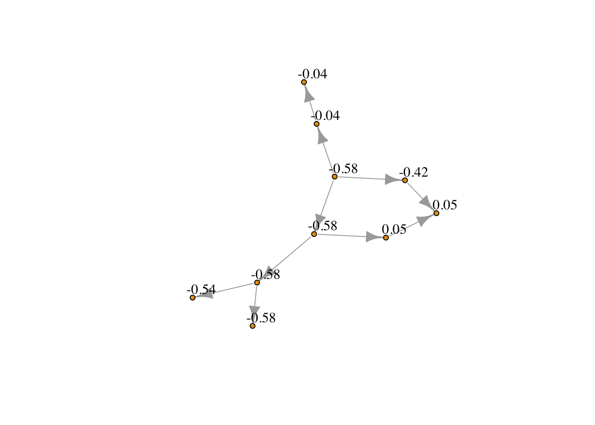
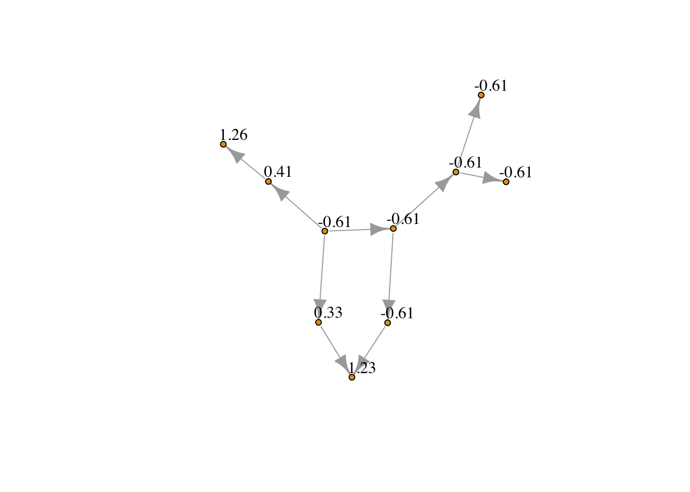

<!-- README.md is generated from README.Rmd. Please edit that file -->


# IsotoneOptimization

<!-- badges: start -->

<!-- badges: end -->

The goal of IsotoneOptimization is to implement the Sequential Block Merging algorithm for solving isotonic regression with constraints represented by arbitrary directed acyclic graph.

## Installation

You can install the development version of IsotoneOptimization from [GitHub](https://github.com/) with:


``` r
# install.packages("devtools")
# devtools::install_github("Xiwen1997/IsotoneRpkg") ## original version with only quadratic objectives 
# devtools::install_github("imn167/IsotoneOptimization") ## version with quadratic and Huber-type losses 
```

## Example

This is a basic example which shows you how to solve a general isotonic regression problem:


``` r
library(IsotoneOptimization)
## basic example code

Emat <- t(matrix( c(1,2,  1,3,  1,4,  2,5,  2,6,  3,7,  4,8,  5,8,  6,9,  6,10),2,10))
# quadatic
x_ordered <- solve_isotone_DAG(rnorm(10), rep(1,10), Emat)$x
# Huber
x_ordered_huber <- solve_isotone_DAG(rnorm(10), rep(1,10), Emat, loss = "huber", delta = .5)$x
```

Using package __igraph__, we can better view the ordered vector by regarding isotonic constraints as the edges of a graph. Namely, $x_i\leq x_j$ if there exists an arrow from node $i$ to node $j$


``` r
library(igraph)
#> 
#> Attaching package: 'igraph'
#> The following objects are masked from 'package:stats':
#> 
#>     decompose, spectrum
#> The following object is masked from 'package:base':
#> 
#>     union
grid_graph <- graph_from_edgelist(Emat)
V(grid_graph)$name <- as.character(round(x_ordered,2))
plot(grid_graph,  vertex.size = 4,          # Smaller nodes
    vertex.label = V(grid_graph)$name, # Set the labels
    vertex.label.cex = 1,   # Slightly smaller font
    vertex.label.dist = 1.4,  # Offset the labels
    vertex.label.color = "black")
```

<div class="figure" style="text-align: center">

<p class="caption">Projection Under Quadratic Loss</p>
</div>


``` r
library(igraph)
grid_graph <- graph_from_edgelist(Emat)
V(grid_graph)$name <- as.character(round(x_ordered_huber,2))
plot(grid_graph,  vertex.size = 4,          # Smaller nodes
    vertex.label = V(grid_graph)$name, # Set the labels
    vertex.label.cex = 1,   # Slightly smaller font
    vertex.label.dist = 1.4,  # Offset the labels
    vertex.label.color = "black")
```

<div class="figure" style="text-align: center">

<p class="caption">Projection Under Huber Loss w Hyperparameter .5</p>
</div>


Some typical isotonic constraints, including chain, binary tree, 2d-grid isotonic constraints, can be defined directed. Simply using __solve_isotone_chain__, __solve_isotone_binary_tree__, and __solve_isotone_2d_grid__, you can solve the corresponding isotone optimization problem!

