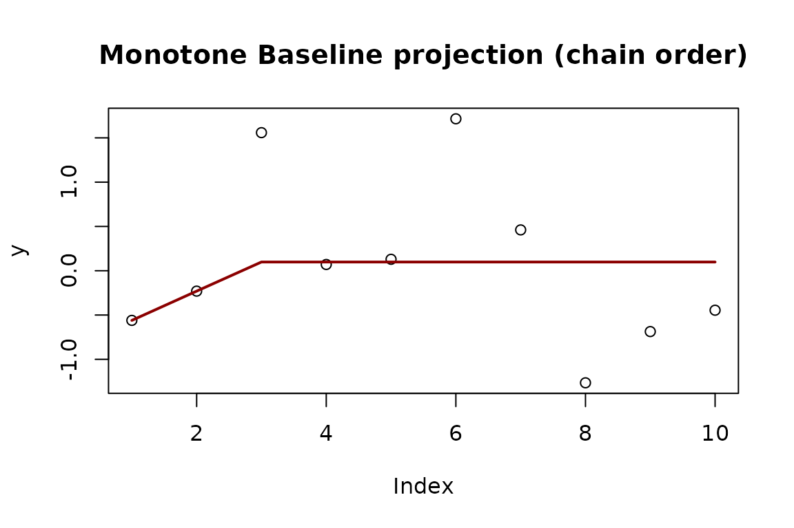
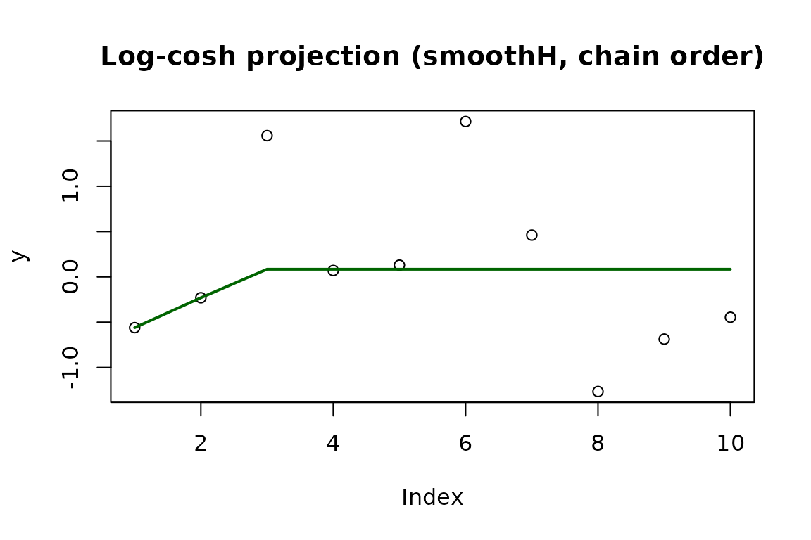

# Sequential Block Merging Algorithm for General Isotonic Optimization under Regularized Huber-type Losses

## Introduction

This article extends the Sequential Block Merging (SBM) algorithm to
isotonic optimization problems whose objective is based on regularized
Huber-type losses.

``` r

library(IsotoneOptimization)
set.seed(123)
y <- rnorm(10)
```

## Notation

Let $`\mathcal{P} \subset \mathbb{R}^n`$ be a closed convex cone of
isotone vectors, $`\theta' \in \mathbb{R}^n`$ the data, and $`w_i > 0`$
the weights. For a vector $`v \in \mathbb{R}^n`$, the weighted squared
norm is

``` math
\|v\|_w^2 = \sum_{i=1}^{n} w_i v_i^2.
```

The reference vector $`c`$ is by default the solution of the quadratic
isotonic regression.

## Huber loss

The Huber loss with threshold $`\delta > 0`$ is

``` math
\rho_\delta(r) =
\begin{cases}
  r^2, & \text{if } |r| \le \delta, \\
  2\delta |r| - \delta^2, & \text{otherwise.}
\end{cases}
```

## Regularized Huber isotonic projection

The regularized Huber projection is

``` math
T_{\mathcal{P}}^{(\delta,\varepsilon)}(\theta') =
\arg\min_{\theta \in \mathcal{P}}
\sum_{i=1}^{n} w_i \rho_\delta(\theta'_i - \theta_i)
+ \varepsilon \, \|\theta - c\|_w^2.
```

For a chain order structure and $`\delta = 0.5`$:

``` r

ordered_huber <- solve_isotone_chain(y, loss = "huber", delta = 0.5)
names(ordered_huber)
#> [1] "x"             "blocks"        "nb_outer_loop" "nb_inner_loop"
#> [5] "converged"     "kantorovich"
```

``` r

plot(y, main = "Huber projection (chain order)")
lines(ordered_huber$x, col = "steelblue", lwd = 2)
```


The block partition found by the algorithm is:

``` r

ordered_huber$blocks
#> [[1]]
#> [1] 1
#> 
#> [[2]]
#> [1] 2
#> 
#> [[3]]
#> [1]  3  4  5  6  7  8  9 10
```

## Monotone Baseline (MBL): component-wise Huber projection

Each component $`i`$ receives its own threshold
$`\delta_i = \dfrac{\delta}{2 w_i}`$. The problem becomes

``` math
T_{\mathcal{P}}^{(\delta,\varepsilon)}(\theta') =
\arg\min_{\theta \in \mathcal{P}}
\sum_{i=1}^{n} w_i \rho_{\delta_i}(\theta'_i - \theta_i)
+ \varepsilon \, \|\theta - c\|_w^2.
```

With $`w_i \sim \mathcal{U}[1,10]`$ and $`\delta = 0.5`$:

``` r

set.seed(123)
w <- runif(10, 1, 10)
ordered_mbl <- solve_isotone_chain(y, w, loss = "mbl", delta = 0.5)
```

``` r

plot(y, main = "Monotone Baseline projection (chain order)")
lines(ordered_mbl$x, col = "darkred", lwd = 2)
```



## Log-cosh isotonic regression (smoothH)

The log-cosh loss with scale $`\delta > 0`$ is

``` math
\rho_\delta(r) = 2\delta^2 \log\cosh\!\left(\frac{r}{\delta}\right), \qquad r \in \mathbb{R}.
```

**Proposition.** Let $`\delta > 0`$. For every
$`\theta' \in \mathbb{R}^n`$, the problem

``` math
T_{\mathcal{P}}^{(\delta)}(\theta') =
\arg\min_{\theta \in \mathcal{P}} \sum_{i=1}^{n} w_i \rho_\delta(\theta'_i - \theta_i)
```

has a unique solution. *(À reformuler selon l’énoncé exact de
l’article.)*

``` r

ordered_logcosh <- solve_isotone_chain(y, loss = "smoothH", delta = 0.5)
```

``` r

plot(y, main = "Log-cosh projection (smoothH, chain order)")
lines(ordered_logcosh$x, col = "darkgreen", lwd = 2)
```


