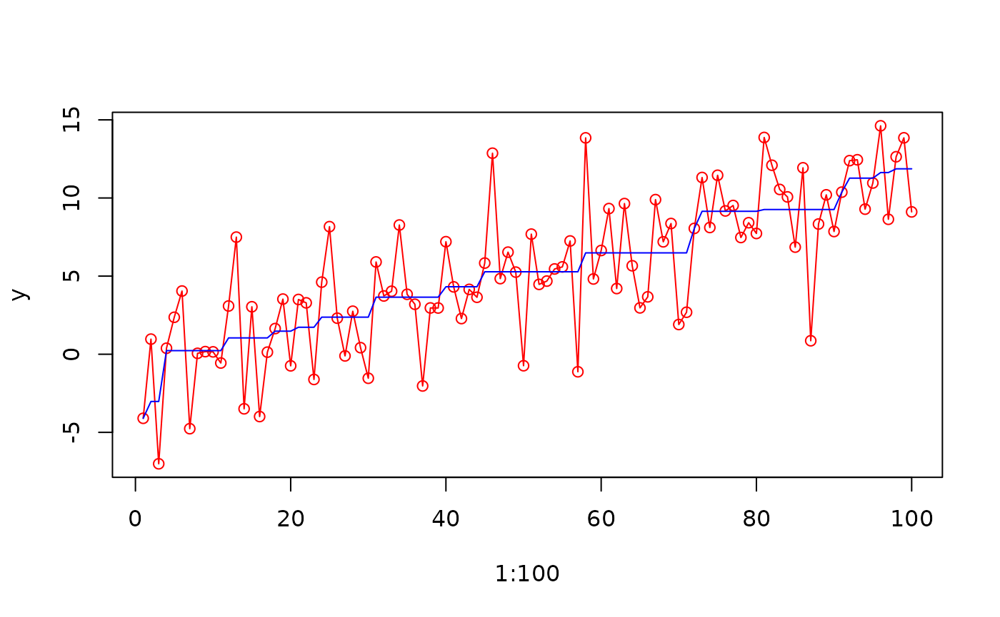
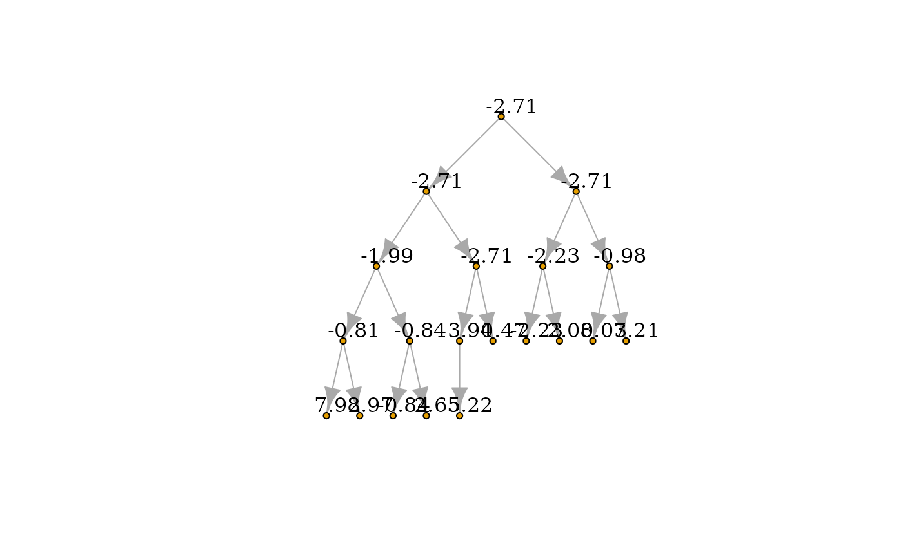
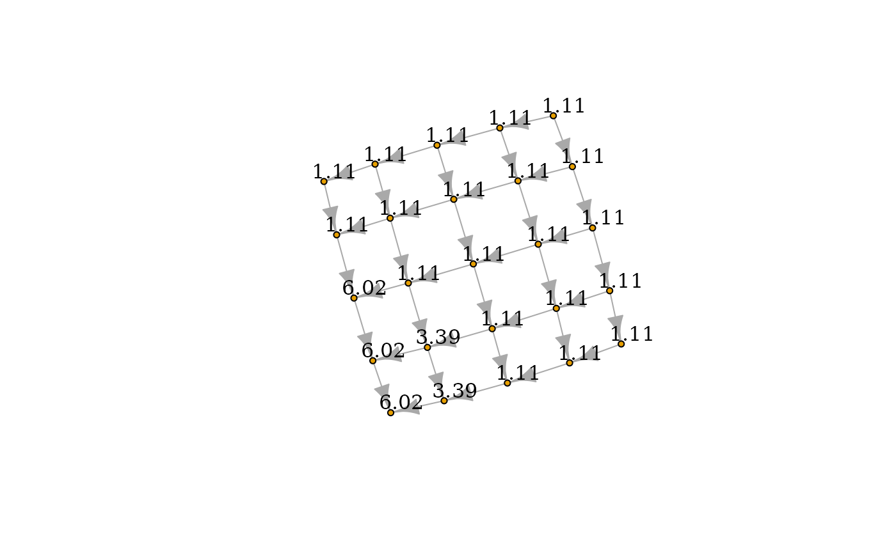
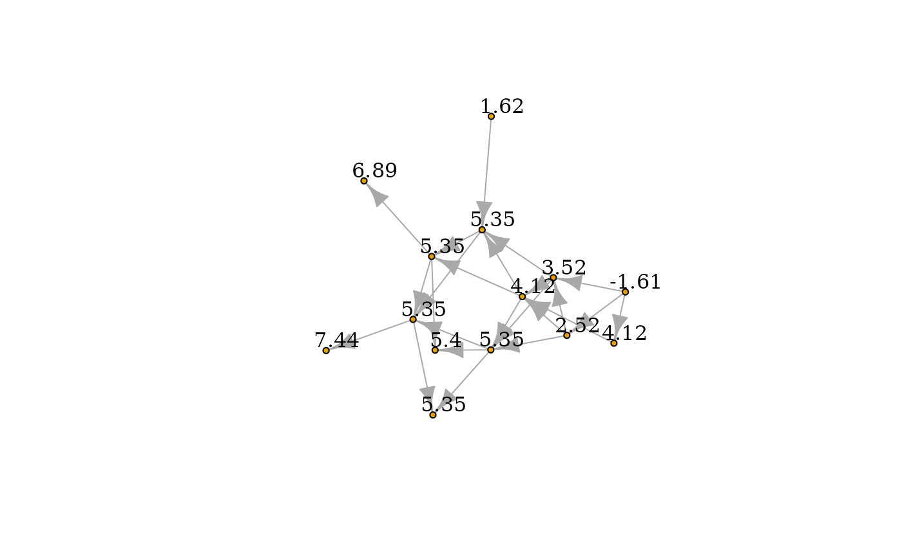

# Sequential Block Merging Algorithm for General Isotone Optimization Under Quadratic Loss

## Quick Start

Let’s first load the package:

``` r

library(IsotoneOptimization)
```

## Solving Isotonic Regression under chain/binary tree/2d-grid isotonic constraints

The package **IsotoneOptimization** implements the Sequential Block
Merging algorithm \[1\] for solving isotonic regression under
constraints that can be represented by arbitrary directed acyclic graph.
Here are some structures which are frequently used.

### Chain isotonic constraints

Given optimization variable $`\mathbf{x}\in \mathbb{R}^n`$, the isotonic
regression under chain isotonic constraints are given as

``` math
\begin{array}{rl} 
\underset{\mathbf{x}}{\mathsf{minimize}} & \frac{1}{2}\left\|\mathbf{x}-\mathbf{y}\right\|_2^2 \\
\mathsf{subject}\text{ }\mathsf{to} & x_1\leq x_2\leq \cdots\leq x_n.
\end{array}
```

``` r

y <- 1:100 /10 + rnorm(100, 0, 3)
y_calibrated <- solve_isotone_chain(y)$x

plot(1:100,y,type="o",col="red")
lines(1:100,y_calibrated,col="blue")
```



### Binary tree isotonic constraints

Given optimization variable $`\mathbf{x}\in \mathbb{R}^n`$, the isotonic
regression under binary isotonic constraints are given as

``` math
\begin{array}{rl} 
\underset{\mathbf{x}}{\mathsf{minimize}} & \frac{1}{2}\left\|\mathbf{x}-\mathbf{y}\right\|_2^2 \\
\mathsf{subject}\text{ }\mathsf{to} & x_i \leq x_{2i} ,i=1,\dots,\left\lceil \frac{n}{2}\right\rceil,\\
 & x_i\leq x_{2i+1},i=1,\dots,\left\lceil \frac{n-1}{2}\right\rceil.
\end{array}
```
We can solve the problem and plot the results via package igraph.

``` r

library(igraph)
p <- 20
# build a tree graph
tr <- make_tree(p, children = 2, mode = "out")
y <- 1:20 /10 + rnorm(20, 0, 3)
y_calibrated <- solve_isotone_binary_tree(y)$x

V(tr)$name <- as.character(round(y_calibrated,2))
plot(tr,  vertex.size = 4,          # Smaller nodes
    vertex.label = V(tr)$name, # Set the labels
    vertex.label.cex = 1,   # Slightly smaller font
    vertex.label.dist = 1.4,  # Offset the labels
    vertex.label.color = "black")
```



### 2d-grid isotonic constraints

Given optimization variable $`\mathbf{x}\in \mathbb{R}^n`$, the isotonic
regression under binary isotonic constraints are given as

``` math
\begin{array}{rl} 
\underset{\mathbf{x}}{\mathsf{minimize}} & \frac{1}{2}\left\|\mathbf{x}-\mathbf{y}\right\|_2^2 \\
\mathsf{subject}\text{ }\mathsf{to} & x_{i+(j-1)\times\left\lfloor\sqrt{n}\right\rfloor} \leq x_{i+1+(j-1)\times\left\lfloor\sqrt{n}\right\rfloor} ,\forall i=1,\dots,\left\lfloor\sqrt{n}\right\rfloor -1,j=1,\dots,\left\lfloor\sqrt{n}\right\rfloor\\
 & x_{i+(j-1)\times\left\lfloor\sqrt{n}\right\rfloor} \leq x_{i+j\times\left\lfloor\sqrt{n}\right\rfloor} ,\forall i=1,\dots,\left\lfloor\sqrt{n}\right\rfloor ,j=1,\dots,\left\lfloor\sqrt{n}\right\rfloor-1,\\
 & x_i\leq x_{i+1},\forall i=\left\lfloor\sqrt{n}\right\rfloor^2,\dots, n-1.
\end{array}
```

We can solve the problem and plot the results via package igraph.

``` r

library(igraph)
p <- 25
sqrt_p <- 5
E_mat <- c()
# build a 2d-grid graph
for(i in 1:4)
  for(j in 1:5) 
    E_mat <- cbind(E_mat, c(i+(j-1)*sqrt_p, i+1+(j-1)*sqrt_p))

for(i in 1:5)
  for(j in 1:4) 
    E_mat <- cbind(E_mat, c(i+(j-1)*sqrt_p, i+j*sqrt_p))

E_mat <- t(E_mat)

y <- 1:p /10 + rnorm(p, 0, 3)
y_calibrated <- solve_isotone_2d_grid(y)$x

grid_graph <- graph_from_edgelist(E_mat)
V(grid_graph)$name <- as.character(round(y_calibrated,2))
plot(grid_graph,  vertex.size = 4,          # Smaller nodes
    vertex.label = V(grid_graph)$name, # Set the labels
    vertex.label.cex = 1,   # Slightly smaller font
    vertex.label.dist = 1.4,  # Offset the labels
    vertex.label.color = "black")
```



## Solving Isotonic Regression with isotonic constraints via arbitrary DAG

We can also define any constraints graph as long as it is directed
acyclic. The below example generate a random DAG. By using the function
**Ordered_DAG**, we solve the following problem

``` math
\begin{array}{rl} 
\underset{\mathbf{x}}{\mathsf{minimize}} & \frac{1}{2}\left\|\mathbf{x}-\mathbf{y}\right\|_2^2 \\
\mathsf{subject}\text{ }\mathsf{to} & x_i \leq x_{j},\forall (i,j)\in \mathcal E.
\end{array}
```

``` r

set.seed(12)
start_nodes <- rep(1:10,3)
end_nodes <- start_nodes + round(runif(30, 1, 5))

E_mat <- cbind(start_nodes, end_nodes)

DAG_graph <- graph_from_edgelist(E_mat)  
DAG_graph <- simplify(
    DAG_graph,
    remove.multiple = TRUE,
    remove.loops = TRUE,
    edge.attr.comb = igraph_opt("edge.attr.comb")
)

E_mat <- as_edgelist(DAG_graph)

y <- 1:max(E_mat)/2 + rnorm(max(E_mat), 0, 3)
y_calibrated <- solve_isotone_DAG(y, rep(1,max(E_mat)), E_mat)$x

V(DAG_graph)$name <- as.character(round(y_calibrated,2))
plot(DAG_graph,  vertex.size = 4,          # Smaller nodes
    vertex.label = V(DAG_graph)$name, # Set the labels
    vertex.label.cex = 1,   # Slightly smaller font
    vertex.label.dist = 1.4,  # Offset the labels
    vertex.label.color = "black")
```



## References

\[1\]

X. Wang, J. Ying, J. V. de M. Cardoso, and D. P. Palomar, “Efficient
algorithms for general isotone optimization,” in *Proceedings of the
AAAI conference on artificial intelligence*, 2022, vol. 36, pp.
8575–8583.
